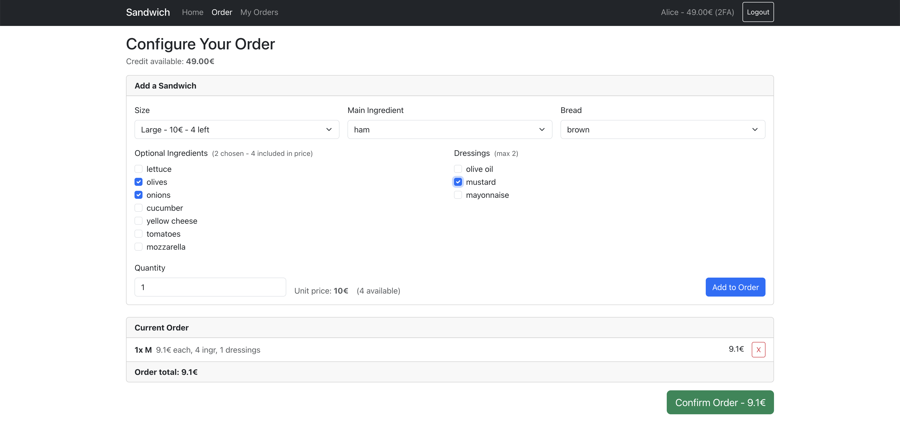

# Sandwich App

A full-stack sandwich-ordering web app, built as a hands-on exercise to get practical experience with a React front end, an Express/SQLite back end, session-based authentication, and optional TOTP two-factor login.

It covers a typical end-to-end flow: browsing a daily menu with live availability, building and confirming an order behind a login wall, and managing past orders — a compact sample of how these pieces fit together in a real app.

## React Client Application Routes

- Route `/`: home page, public. Shows today's S/M/L availability and the menu (mains, breads, ingredients, dressings).
- Route `/login`: login form (username/password), then an optional TOTP step if the user has 2FA. Public.
- Route `/configurator`: build and confirm a new order. Requires login, redirects to `/login` if not authenticated.
- Route `/orders`: list own confirmed orders, duplicate into a new draft, delete an order. Requires login, redirects to `/login` if not authenticated.
- Route `*`: catch-all, redirects to `/`.

## API Server

### Public browse routes

- GET `/api/sizes`
  - no parameters
  - response: array of `{ code, name, base_price, included_ingredients, max_dressings, daily_limit, available }`, `available` computed from confirmed orders.
- GET `/api/main-ingredients`
  - no parameters
  - response: array of `{ id, name }`.
- GET `/api/breads`
  - no parameters
  - response: array of `{ id, name }`.
- GET `/api/ingredients`
  - no parameters
  - response: array of `{ id, name }`.
- GET `/api/dressings`
  - no parameters
  - response: array of `{ id, name }`.

### Auth / session routes

- POST `/api/sessions` - public
  - body: `{ username, password }`.
  - response: `clientUserInfo` object `{ id, username, name, credit, canDoTotp, isTotp }`. Errors: 422 invalid input, 401 wrong credentials.
- GET `/api/sessions/current` - requires login
  - no parameters
  - response: `clientUserInfo` object. Error: 401 if not authenticated.
- DELETE `/api/sessions/current` - public (logs out current session if any)
  - no parameters
  - response: empty object `{}`. Error: 500 on logout failure.

### TOTP route

- POST `/api/login-totp` - requires login
  - body: `{ code }`.
  - response: `{ otp: 'authorized' }`. Errors: 400 if the user has no 2FA secret, 422 missing code, 401 invalid/expired/replayed code.

### Order routes

- POST `/api/orders` - requires login
  - body: `{ sandwiches: [{ size, main_id, bread_id, quantity, ingredient_ids, dressing_ids }] }`.
  - response: `{ id, total, credit }`. Errors: 422 invalid input (bad size/quantity/ids or too many dressings), 409 not enough sandwiches of a size, 422 insufficient credit.
- GET `/api/orders` - requires login
  - no parameters
  - response: array of the caller's own orders, each `{ id, total, sandwiches: [{ id, size_code, main_id, bread_id, quantity, unit_price, ingredients, dressings }] }`.
- DELETE `/api/orders/:id` - requires login, ownership (checked against `req.user.id`) and 2FA done in session
  - `:id` in the URL is the order id.
  - response: `{ credit }` after a 90% refund. Errors: 404 if not found or not owned, 401 if 2FA was not done this session.

## Database Tables

- Table `sizes` - size catalogue and rules. Columns: `code, name, base_price, included_ingredients, max_dressings, daily_limit`.
- Table `main_ingredients` - the 3 main ingredient choices. Columns: `id, name`.
- Table `breads` - the 2 bread choices. Columns: `id, name`.
- Table `ingredients` - the 7 optional ingredients. Columns: `id, name`.
- Table `dressings` - the 3 dressing choices. Columns: `id, name`.
- Table `users` - accounts, credentials and TOTP state. Columns: `id, username, name, hash, salt, credit, secret, last_totp_step`.
- Table `orders` - one row per confirmed order. Columns: `id, user_id, total`.
- Table `order_sandwiches` - one row per configured sandwich line in an order. Columns: `id, order_id, size_code, main_id, bread_id, quantity, unit_price`.
- Table `sandwich_ingredients` - optional ingredients chosen for a sandwich line. Columns: `sandwich_id, ingredient_id`.
- Table `sandwich_dressings` - dressings chosen for a sandwich line. Columns: `sandwich_id, dressing_id`.

## Main React Components

- `App` (in `App.jsx`): sets up routes, tracks the logged-in user, holds `UserContext`.
- `NavHeader` (in `components/NavHeader.jsx`): nav bar with links, username, credit, login/logout.
- `HomePage` (in `components/HomePage.jsx`): fetches and displays availability and the menu.
- `LoginForm` (+ inline `TotpForm`, in `components/LoginForm.jsx`): username/password login, optional TOTP step, updates `UserContext`.
- `Configurator` (+ inline `SandwichForm` and `DraftList`, in `components/Configurator.jsx`): builds a draft order with live unit price, live availability and live order total/discount, confirms via `POST /api/orders`.
- `OrdersPage` (+ inline `OrderItem`, in `components/OrdersPage.jsx`): lists own confirmed orders, duplicates one into the configurator, deletes one (disabled unless 2FA was done).

(only _main_ components, minor ones may be skipped)

## Screenshot

## Users Credentials

- alice, pwd12345 - can use 2FA (optional at login), starting credit 49€ (100€ minus 3 confirmed orders).
- bob, pwd12345 - no 2FA, starting credit 71€ (100€ minus 3 confirmed orders).
- carol, pwd12345 - can use 2FA (optional at login), starting credit 100€, no orders yet.
- dave, pwd12345 - no 2FA, starting credit 100€, no orders yet.
